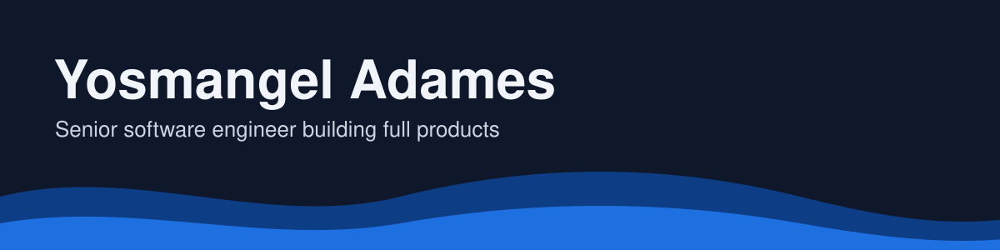
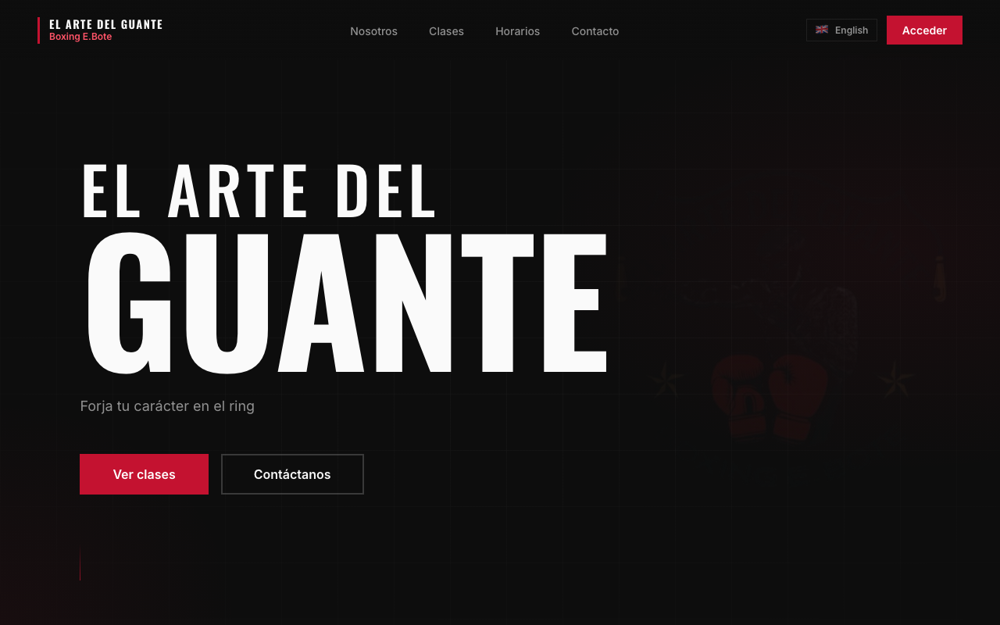

[English](README.md) · **Español**

Soy senior software engineer en España y desarrollo software profesionalmente desde 2015. Desde 2022 estoy en Celonis, donde trabajo sobre todo con Angular y diseño funcionalidades que encajen en la arquitectura existente, desde el monorepo de frontend hasta los servicios de backend. Además, ejerzo como líder de frontend en mi equipo.

Fuera del trabajo, me gusta llevar una idea hasta producción. Los proyectos que verás aquí son míos y cubren todo el stack: Angular y TypeScript en el frontend, Python y NestJS en el backend.

[LinkedIn](https://www.linkedin.com/in/yosmangel-adames) · [Mis proyectos personales están en `studio`](https://github.com/yosmangelV/studio)

## Qué estoy construyendo

### [Boxing Gym](https://boxing-gym-ten.vercel.app)
Web y app de gestión para escuelas de boxeo: alumnos, pagos y clases. Hoy funciona en El Arte del Guante, y la estoy convirtiendo en una plantilla que otras escuelas puedan adoptar con pocos cambios.

Angular · FastAPI · Supabase · [Código](https://github.com/yosmangelV/studio/tree/main/projects/boxing-gym)

### Announcement Web
Un anuncio de bebé personalizado, contado como una historia animada. Es privado a propósito: solo lo abren familiares y amigos con su propio enlace, así que no tiene demo pública.

Angular · NestJS · MongoDB · [Código](https://github.com/yosmangelV/studio/tree/main/projects/announcement-web)

### Librería de componentes compartida
Los componentes de Angular y los tokens de diseño sobre los que se construyen estas apps, documentados en [Storybook](https://main--6aa5a635a53be81ff5ff530b.chromatic.com).

Angular · Tailwind · SCSS · [Código](https://github.com/yosmangelV/studio/tree/main/projects/design-system)

Vienen más ideas en camino, entre ellas nuevos proyectos de backend.

## Cómo trabajo

- **La accesibilidad cuenta desde el principio.** El contraste de color se comprueba en CI, así que un color que no cumple rompe la build.
- **Los cambios pasan por revisión.** Trabajo con pull requests y comprobaciones automáticas, también en mis propios proyectos.
- **Productos reales, despliegues reales.** Mis frontends corren en Vercel y mis APIs en Render.

## Herramientas que uso

- **Frontend:** Angular, TypeScript, Tailwind CSS, SCSS, Storybook
- **Backend:** Python, FastAPI, NestJS, PostgreSQL (Supabase), MongoDB
- **Flujo de trabajo:** Nx, GitHub Actions, Vercel, Render

<picture>
  <source media="(prefers-color-scheme: dark)" srcset="https://raw.githubusercontent.com/yosmangelV/yosmangelV/output/github-snake-dark.svg" />
  
</picture>
