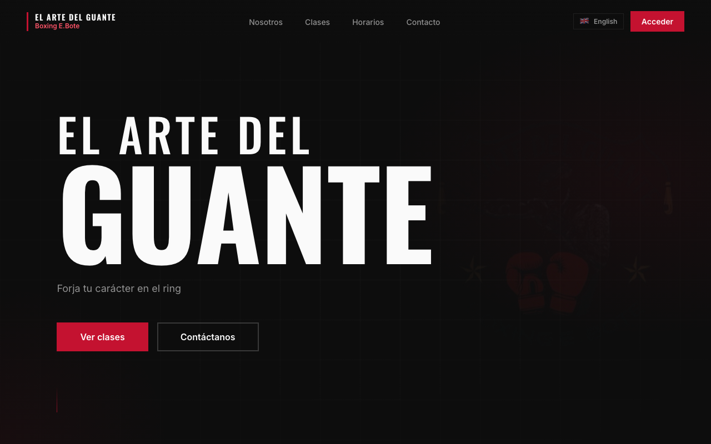

**English** · [Español](README.es.md)

I'm a frontend developer based in Spain who likes taking an idea all the way to production. I mostly work with Angular and TypeScript, and I've been building more of the backend myself with Python and NestJS.

[LinkedIn](https://www.linkedin.com/in/yosmangel-adames) · [All my work lives in `studio`](https://github.com/yosmangelV/studio)

## What I'm building

### [Boxing Gym](https://boxing-gym-ten.vercel.app)
A website and management app for boxing schools, covering students, payments and classes. It runs today at El Arte del Guante, and I'm shaping it into a template that other schools can adopt with a few changes.

Angular · FastAPI · Supabase · [Code](https://github.com/yosmangelV/studio/tree/main/projects/boxing-gym)

### Announcement Web
A personalized baby announcement told as an animated story. It's private by design: only family and friends with their own link can open it, so there's no public demo.

Angular · NestJS · MongoDB · [Code](https://github.com/yosmangelV/studio/tree/main/projects/announcement-web)

### Shared component library
The Angular components and design tokens these apps build on, documented in [Storybook](https://main--6aa5a635a53be81ff5ff530b.chromatic.com).

Angular · Tailwind · SCSS · [Code](https://github.com/yosmangelV/studio/tree/main/projects/design-system)

More ideas are on the way, including new backend projects.

## How I work

- **Accessibility counts from the start.** Colour contrast is tested in CI, so a failing colour breaks the build.
- **Changes go through review.** I work in pull requests with automated checks, even on my own projects.
- **Real products, real deploys.** My frontends run on Vercel and my APIs on Render.

## Tools I use

- **Frontend:** Angular, TypeScript, Tailwind CSS, SCSS, Storybook
- **Backend:** Python, FastAPI, NestJS, PostgreSQL (Supabase), MongoDB
- **Workflow:** Nx, GitHub Actions, Vercel, Render

<picture>
  <source media="(prefers-color-scheme: dark)" srcset="https://raw.githubusercontent.com/yosmangelV/yosmangelV/output/github-snake-dark.svg" />
  
</picture>
